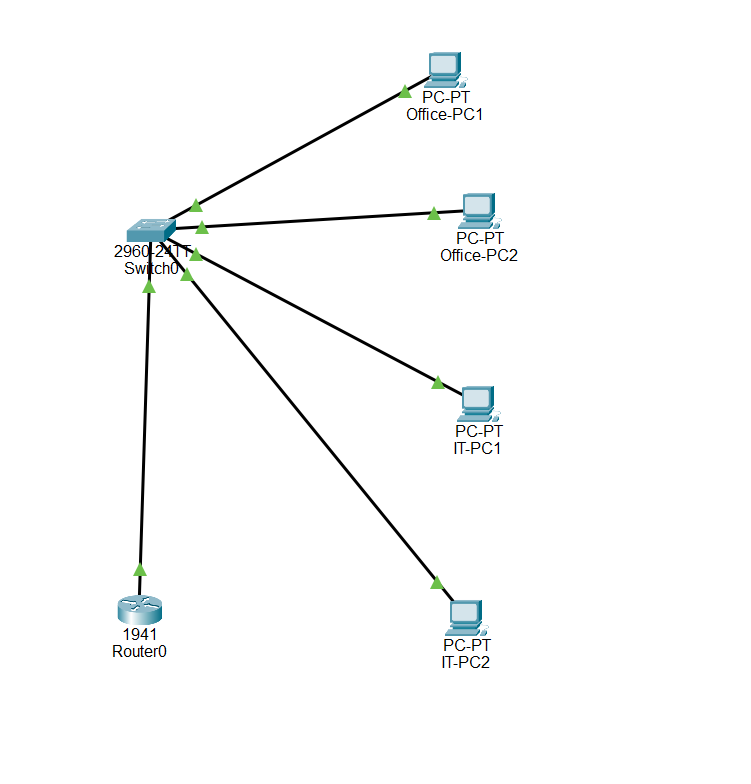

# Small Office Network Lab

## Overview

This project is a simulated small office network built in Cisco Packet Tracer. It connects two departments, uses DHCP to assign IP addresses automatically, and provides connectivity between the departments.

## Skills Practised

- Building a network topology in Cisco Packet Tracer
- Configuring DHCP for automatic IP address assignment
- Testing connectivity between departments
- Working with IP addressing

## Project File

The `.pkt` file in this repository can be opened in Cisco Packet Tracer.

## Network Topology

## VLAN Configuration

- VLAN 10 — OFFICE: switch ports FastEthernet 0/1 and 0/2
- VLAN 20 — IT: switch ports FastEthernet 0/3 and 0/4

## Network Configuration

- VLAN 10 (OFFICE): 192.168.10.0/24
- VLAN 20 (IT): 192.168.20.0/24
- Configured DHCP pools on the router for both departments.
- Configured router subinterfaces with 802.1Q encapsulation
  for inter-VLAN routing using the router-on-a-stick approach.

## Connectivity Testing

- Tested connectivity from Office-PC1 in VLAN 10 to
  IT-PC1 in VLAN 20 using ping.
- Result: 4 packets sent, 4 received, 0% packet loss.
