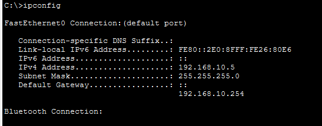
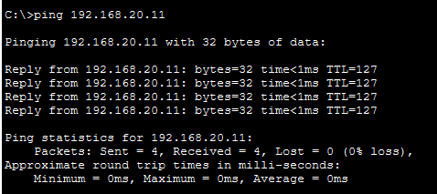
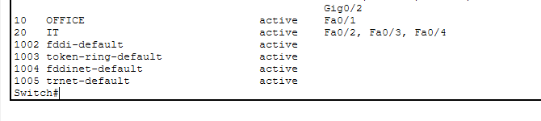
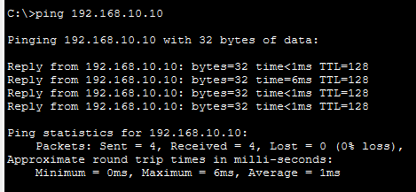
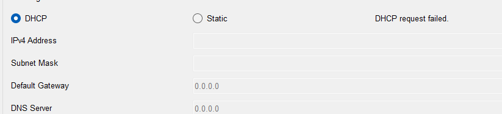
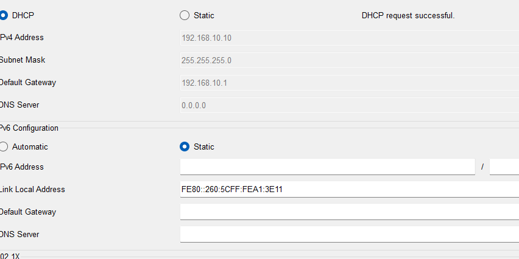
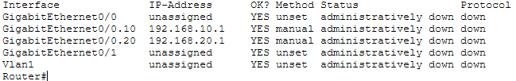
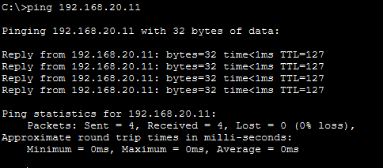

# Small Office Network Lab

## Overview

This project is a simulated small office network built in Cisco Packet Tracer. It connects two departments, uses DHCP to assign IP addresses automatically, and provides connectivity between the departments.

## Skills Practised

- Building a network topology in Cisco Packet Tracer
- Configuring DHCP for automatic IP address assignment
- Testing connectivity between departments
- Working with IP addressing

## Project File

The `.pkt` file in this repository can be opened in Cisco Packet Tracer.

## Network Topology

## VLAN Configuration

- VLAN 10 — OFFICE: switch ports FastEthernet 0/1 and 0/2
- VLAN 20 — IT: switch ports FastEthernet 0/3 and 0/4

## Network Configuration

- VLAN 10 (OFFICE): 192.168.10.0/24
- VLAN 20 (IT): 192.168.20.0/24
- Configured DHCP pools on the router for both departments.
- Configured router subinterfaces with 802.1Q encapsulation
  for inter-VLAN routing using the router-on-a-stick approach.

## Connectivity Testing

- Tested connectivity from Office-PC1 in VLAN 10 to
  IT-PC1 in VLAN 20 using ping.
- Result: 4 packets sent, 4 received, 0% packet loss.

## Network Troubleshooting Lab

I practised troubleshooting by introducing four faults, one at a time,
in a copy of the working network. For each scenario, I observed the
symptoms, checked the configuration, corrected the fault, and retested
connectivity.

All faults were resolved at the end of the exercise.

### 1. Incorrect Default Gateway

- **Symptom:** Office-PC1 could reach Office-PC2 in the same subnet,
  but could not reach IT-PC1 in VLAN 20.
- **Checks:** Used `ping` to compare local and inter-VLAN connectivity.
  Used `ipconfig` to inspect Office-PC1's network settings.
- **Cause:** Office-PC1's default gateway was set to `192.168.10.254`
  instead of `192.168.10.1`.
- **Fix:** Changed the default gateway to `192.168.10.1`.
- **Retest:** Ping to IT-PC1 (`192.168.20.11`) succeeded with
  4 replies and 0% packet loss.
  

### 2. Incorrect Switch Port VLAN

- **Symptom:** Office-PC1 could not reach Office-PC2 (`192.168.10.10`).
- **Checks:** Ping showed 100% packet loss. Used `show vlan brief`
  to inspect switch port assignments.
- **Cause:** Office-PC2's switch port, `Fa0/2`, was assigned to VLAN 20
  while the PC retained its VLAN 10 subnet address.
- **Fix:** Returned `Fa0/2` to VLAN 10 using
  `switchport access vlan 10`.
- **Retest:** Ping to Office-PC2 succeeded with 4 replies
  and 0% packet loss.
  
  

### 3. Disabled DHCP Service

- **Symptom:** Office-PC2 displayed `DHCP request failed`
  when requesting network settings.
- **Checks:** Repeated the DHCP request on the client and reviewed
  the router configuration using `show running-config`.
- **Cause:** DHCP service on the router had been disabled using
  `no service dhcp`.
- **Fix:** Enabled DHCP using `service dhcp` and requested
  network settings again on Office-PC2.
- **Retest:** Office-PC2 received `192.168.10.10/24` with gateway
  `192.168.10.1`. Pings to the gateway and IT-PC1 succeeded
  with 0% packet loss.

  

### 4. Administratively Disabled Router Interface

- **Symptom:** Office-PC2 could reach Office-PC1 in the same VLAN,
  but could not reach IT-PC1 in VLAN 20.
- **Checks:** Used `ping` and `show ip interface brief`.
  The router's `Gi0/0` interface showed `administratively down`.
- **Cause:** The router interface connecting to the switch
  had been disabled using `shutdown`.
- **Fix:** Enabled `GigabitEthernet0/0` using `no shutdown`.
- **Retest:** Ping to IT-PC1 (`192.168.20.11`) succeeded with
  4 replies and 0% packet loss.

  

## Troubleshooting Skills Practised

- Comparing local and inter-VLAN connectivity
- Checking IP addresses, subnet masks, and default gateways
- Verifying switch port VLAN assignments
- Diagnosing DHCP service failures
- Identifying administratively disabled interfaces
- Documenting symptoms, checks, causes, fixes, and retest results

## Lab Notes

IP addresses listed in the troubleshooting scenarios reflect the
settings used during the exercise. DHCP-assigned addresses may change.
